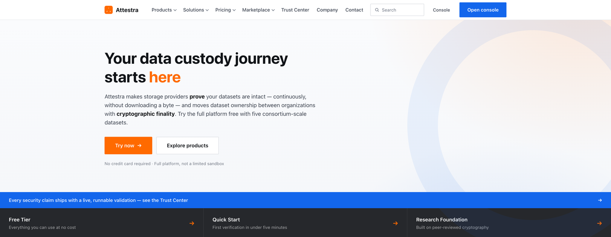
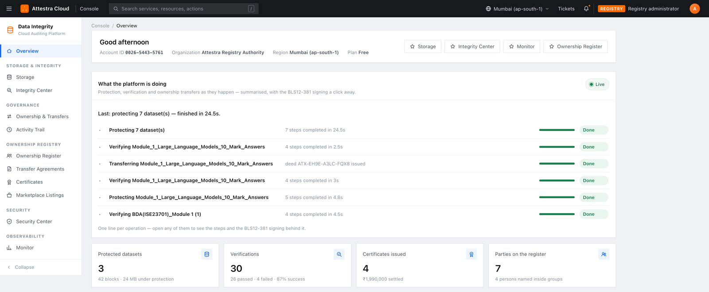

# Cloud-Based Auditing System with Efficient Ownership Management for Group Data Transaction

**Attestra** is a cloud-auditing platform for datasets owned by groups. It proves that data
held by a cloud provider is still intact without downloading it, lets several organisations
own one dataset without sharing secrets, and transfers ownership cryptographically when the
data is sold: after a sale the buyer can verify the data and the seller provably cannot, and
a signed certificate records the transfer for anyone to check.

The protocol is an implementation of a 2025 IEEE Transactions on Information Forensics and
Security scheme, built from the paper's equations on the BLS12-381 pairing curve.

**Live platform:** https://attestra-registry.onrender.com
(free hosting: the first visit after a quiet period can take up to a minute to load)



---

## What it does

- **Integrity audits.** A third-party auditor challenges random blocks and checks a proof of
  about 128 bytes, whatever the size of the dataset.
- **Group ownership at linear cost.** Key generation and membership changes grow linearly with
  the number of owners, not quadratically: 10.5 times faster than the earlier scheme at 20
  owners.
- **Ownership transfer in place.** A sale re-seals the stored blocks for the buyer without
  moving the data. The seller's credentials stop verifying the moment the transfer completes.
- **Verifiable certificates.** Every transfer issues an Ed25519-signed certificate that anyone
  can verify on the public Verify page, without an account.
- **Attack demonstrations.** Collusion, rogue-key and tampering attacks are run against the
  earlier scheme, where they succeed, and against this one, where they fail.
- **A complete web platform.** Public site, user console, ownership register, marketplace,
  signed transfer agreements and continuous integrity monitoring.



---

## Running it on your computer

Requires an internet connection the first time. Python 3.10 or newer is used if installed;
otherwise the start script downloads a private copy into the project folder.

| System | Command (from the repository folder) |
|---|---|
| Windows | double-click `START-WINDOWS.bat`, or run it in Command Prompt |
| macOS | `bash START-MAC.command` |
| Any, with Python 3.10+ | `python start.py` |

The first start creates a virtual environment in `.venv/`, installs the libraries, generates
the five sample datasets, loads a demonstration scenario and opens
**http://127.0.0.1:5050** in the browser. Later starts take a few seconds. Press Ctrl+C in
the terminal to stop it.

Demo sign-in for the local copy: `demo@attestra.test` / `examiner2026`

Options: `--port N`, `--no-browser`, `--no-demo` (start empty), `--reseed` (rebuild the demo).

### Manual setup

```bash
python -m venv .venv
source .venv/bin/activate                 # Windows: .venv\Scripts\activate
pip install -r web/requirements.txt -r code/requirements.txt
cd code && python -m datasets.generate --dataset all --size medium && cd ..
cd web && python app.py                   # http://127.0.0.1:5000
```

### The protocol on its own

```bash
cd code
python -m demo.run_demo                   # the whole protocol, step by step
python -m attacks.collusion               # buyer and cloud collude: prior scheme broken, this one holds
python -m attacks.rogue_key               # fake co-ownership: blocked
python -m attacks.tampering               # corrupted blocks: always detected
pytest tests -q                           # 41 automated tests
python -m benchmarks.run_benchmarks       # measured cost of every algorithm
```

---

## Results

| Measurement | Result |
|---|---|
| Automated tests | 41 passing |
| Key generation, 20 owners | 1,486 ms against 15,540 ms for the earlier scheme (10.5x) |
| Group doubled from 10 to 20 owners | cost x1.99 here, x3.81 for the earlier scheme |
| Audit proof size | about 128 bytes, independent of data size |
| Verification, 1 owner against 10 owners | 692.6 ms against 692.1 ms |

The cryptography is pure Python (py_ecc) so that it installs anywhere without a compiler;
absolute timings are therefore in milliseconds, and the comparison concerns how cost grows.

---

## Repository layout

| Path | Contents |
|---|---|
| `code/` | The protocol: `crypto/` (SysGen, KeyGen, TagGen, Audit, OwnerModify, OwnerTransfer), `entities/` (cloud, auditor, owner group), `datasets/`, `attacks/`, `benchmarks/`, `tests/` |
| `web/` | The Attestra platform (Flask): routes, services, templates, static files |
| `start.py`, `START-*` | One-command launcher for Windows and macOS |
| `render.yaml` | Render deployment blueprint |
| `fly.io/` | Dockerfile, start-up script and Gunicorn settings used by the deployment |
| `render/` | Step-by-step deployment notes |
| `Docs/`, `report/` | Project documentation, report chapters and diagrams |

---

## Deployment

The live platform runs on **Render** as a single Docker web service built from this
repository (`render.yaml`, `fly.io/Dockerfile`). Its SQLite database is replicated
continuously to **Supabase Storage** with Litestream and restored on every start, which is
what lets it run on a plan without a permanent disk. The certificate-signing key is supplied
through the `ATTESTRA_ISSUER_KEY` environment variable. Setup steps are in
[`render/README.md`](render/README.md).

The platform calls no third-party API. Live data, uploaded files and keys are never committed:
`web/instance/` is ignored.

**Stack:** Python 3.12, Flask, Flask-Login, SQLAlchemy, py_ecc (BLS12-381), cryptography
(Ed25519), SQLite, Litestream, Gunicorn, Docker, Render, Supabase, HTML, CSS, JavaScript.

---

## Team

Major Project, Department of Information Science and Engineering,
Global Academy of Technology, Bengaluru (Team 28)

- Sanjay G P (1GA23IS141)
- Shashank Gowda T K (1GA23IS144)
- Srujangouda Malipatil (1GA23IS165)
- Yashwanth Gowda D K (1GA23IS188)

## Reference

C. Wu, W. You and X. Huang, "Scalable Cloud Auditing With Efficient Ownership Transfer for
Group Transactions," *IEEE Transactions on Information Forensics and Security*, vol. 20, 2025.
[doi:10.1109/TIFS.2025.3636056](https://doi.org/10.1109/TIFS.2025.3636056)
